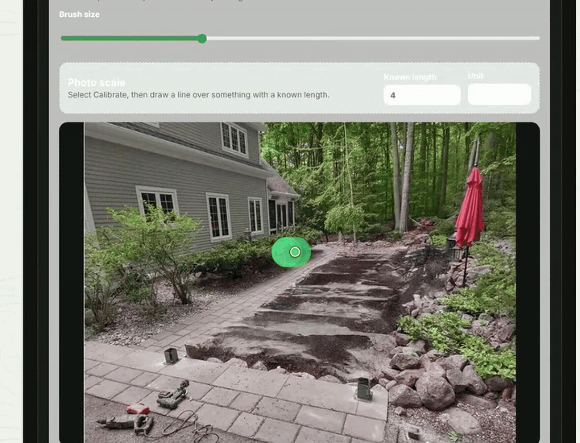
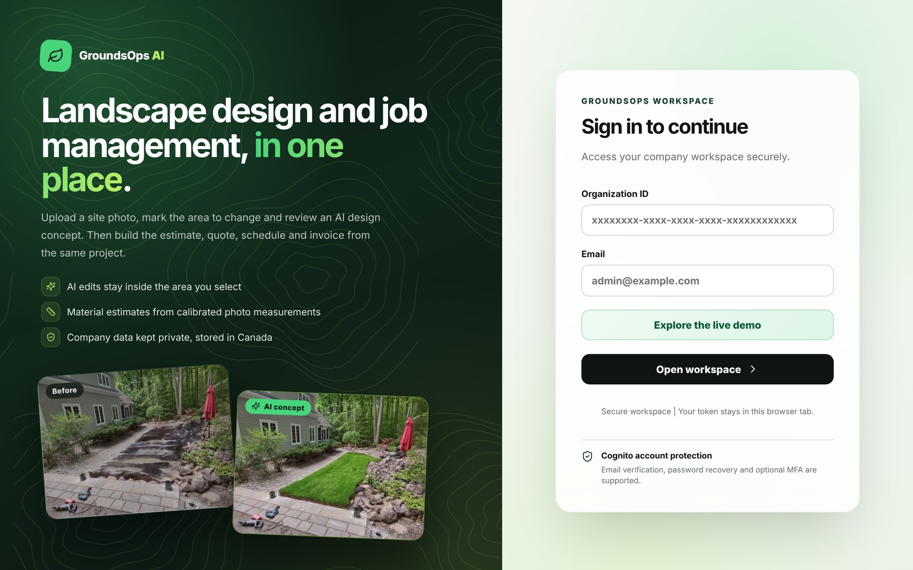
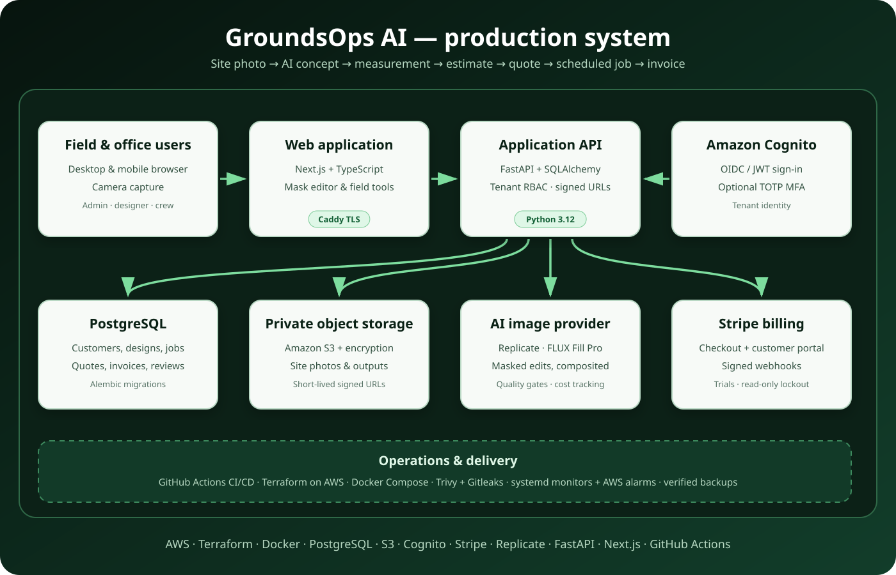
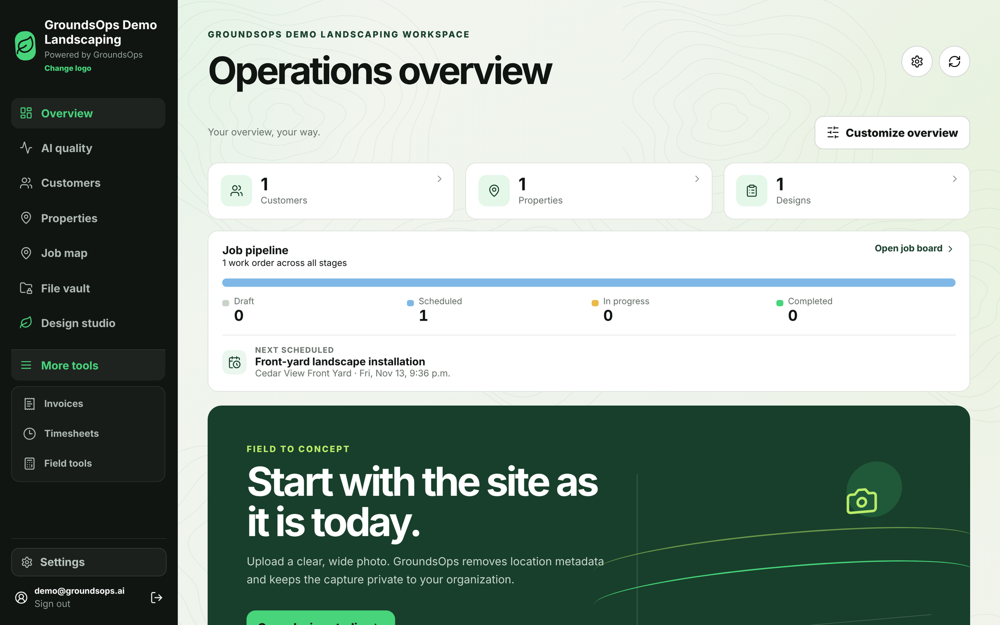
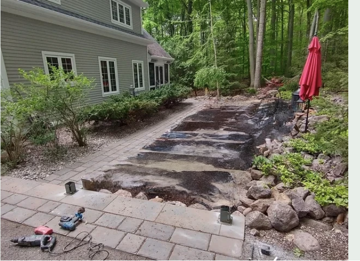
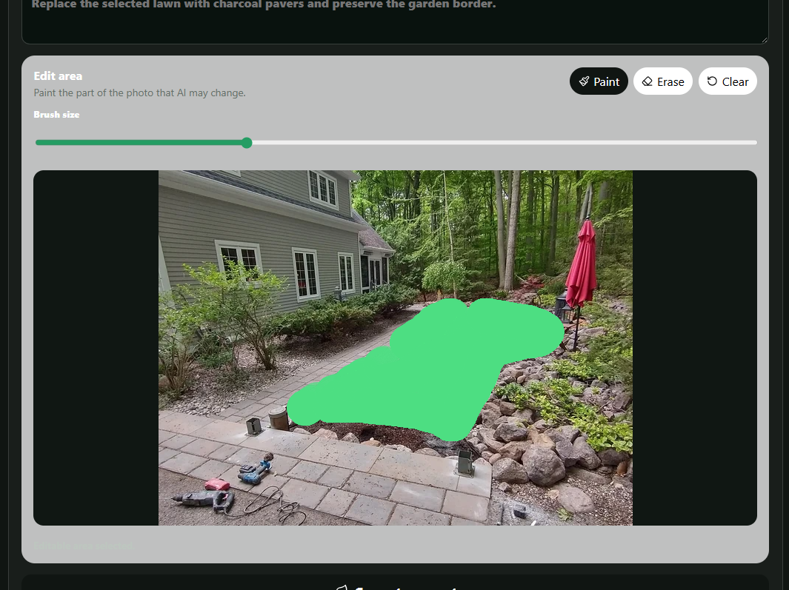
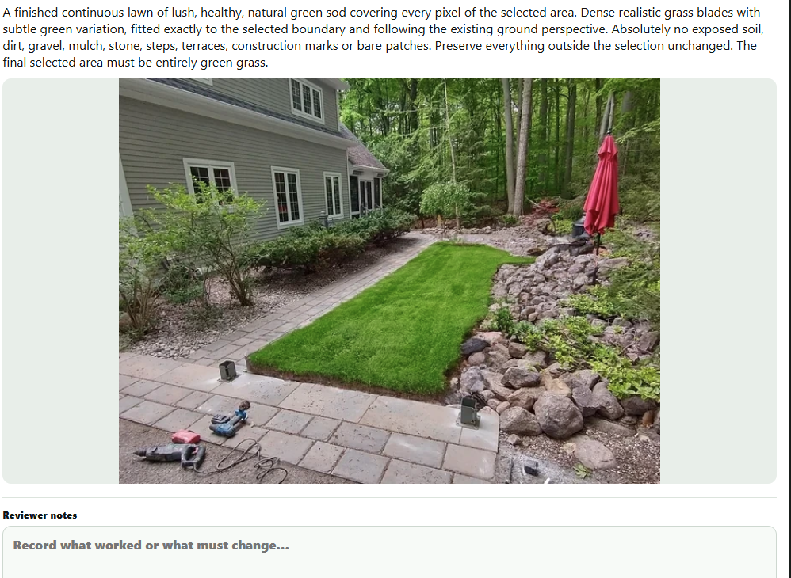
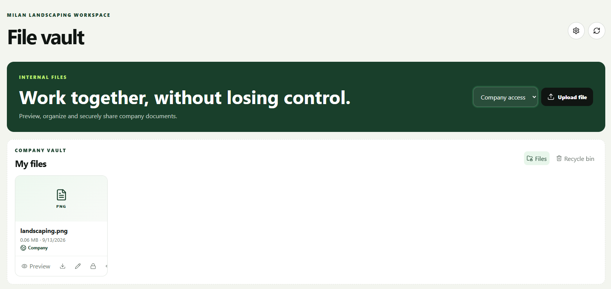

# GroundsOps AI

GroundsOps AI is a production-oriented landscaping operations platform that turns a site photo into an actionable job: AI-assisted concept generation, calibrated area measurement, material estimates, quotes, scheduling, crew execution, invoicing and payment tracking.

> **About this repository.** This is the public showcase copy of GroundsOps AI, built and operated by
> [Francesco Cheema](https://github.com/FrancescoCheema) ([LinkedIn](https://linkedin.com/in/francesco-cheema-18959b227)).
> The staging deployment, monitoring and smoke-test workflows run on a self-hosted runner in the private
> repository and are omitted here. The source is shared for evaluation only; see [LICENSE](LICENSE).

## Demo

Paint the area to change, generate the concept, and only the selected ground changes. The calibrated area (214 sq ft) carries straight into the material estimate.

<p align="center">
  
</p>

<p align="center">
  
</p>

<p align="center">
  
</p>

## Product workflow

1. Create a customer and property.
2. Upload or capture a site photo.
3. Paint the exact area that may change.
4. Generate and review an AI landscape concept.
5. Convert calibrated area measurements into material and labour estimates.
6. Build and approve a quote.
7. Schedule a work order and assign crew.
8. Complete the job, compare actuals and issue an invoice.

## Platform screenshots

### Operations overview

<p align="center">
  
</p>

### Original site photo

The unmodified property image is retained as the visual reference before any selection or AI edit is applied.

<p align="center">
  
</p>

### In-browser landscape selection

The designer brushes only the area the model may change. Everything outside the selection remains protected.

<p align="center">
  
</p>

### Evaluated AI concept output

<p align="center">
  
</p>

### Private company file vault

<p align="center">
  
</p>

## Technology

| Layer | Tools |
|---|---|
| Frontend | Next.js, React, TypeScript, responsive CSS, Canvas APIs |
| Backend | FastAPI, Pydantic, SQLAlchemy, Alembic, Python 3.12 |
| Data | PostgreSQL, private S3 object storage, encrypted backups |
| AI | Replicate provider interface, FLUX Fill Pro, deterministic mock provider |
| Identity | Amazon Cognito, OIDC/JWT, tenant RBAC, optional TOTP MFA |
| Billing | Stripe Checkout, customer portal, signed webhooks, trial and read-only lockout |
| Delivery | Docker, Docker Compose, Caddy, GitHub Actions, AWS Lightsail |
| Quality | Pytest, Ruff, Playwright, npm audit, pip-audit |
| Security | Gitleaks, Trivy, private storage, signed URLs, rate limiting |
| Operations | JSON request logs, readiness checks, systemd monitoring, AWS alarms |

## Plans and billing

Each company workspace starts with a 14-day free trial, then subscribes to **GroundsOps Pro** through
Stripe Checkout. Admins manage cards, invoices and cancellation in the Stripe customer portal. If a trial
ends or a subscription lapses the workspace becomes read-only rather than deleted, so no customer data
is ever held hostage. See [docs/BILLING.md](docs/BILLING.md) for the lifecycle and Stripe setup.

## Architecture and reliability

- Organization-scoped access controls isolate tenant data.
- Site photos and generated concepts remain private and are delivered with short-lived signed URLs.
- AI generations record provider, model, latency, estimated cost, evaluation results and reviewer decisions.
- Paid generation is disabled in CI and the public demo; both use a deterministic mock provider.
- Staging deployment runs backend, frontend, migration and browser workflow validation before release.
- Database backups, container state, disk, memory and public readiness are checked automatically.

## Live demo

The dedicated demo environment contains seeded customer, property, design, quote, work order and invoice records. It uses development authentication only inside the isolated demo deployment and forces `INFERENCE_PROVIDER=mock`, preventing paid Replicate requests.

```bash
DEMO_WORKSPACE_ENABLED=true AUTH_MODE=development \
  python scripts/seed-demo-workspace.py
```

Never enable demo authentication in a customer or production environment.

## Local development

```bash
python -m venv .venv
source .venv/bin/activate
python -m pip install -e ".[dev]"
alembic upgrade head
uvicorn groundsops.main:app --reload
```

In another terminal:

```bash
cd frontend
npm ci
npm run dev
```

## Validation

```bash
ruff check .
pytest
cd frontend
npm ci
npm run build
npm run test:e2e
```

## Release

The project is ready for `v1.0.0` when backend, frontend, E2E, dependency audits, secret scanning, container scanning, staging deployment, smoke tests, backup verification and the demo walkthrough all pass.

See the [operations runbook](docs/OBSERVABILITY.md) and [billing setup](docs/BILLING.md).

## Security, privacy and operations

- [Security policy](SECURITY.md)
- [Privacy notice template](PRIVACY.md)
- [Terms template](TERMS.md)
- [Support policy](SUPPORT.md)
- [Data retention](docs/DATA_RETENTION.md)
- [Recovery runbook](docs/RECOVERY.md)
- [Controlled beta runbook](docs/BETA_RUNBOOK.md)
- [Public release checklist](docs/PUBLIC_RELEASE_CHECKLIST.md)

Production vault uploads are size-limited and scanned by ClamAV. Site images are decoded and re-encoded into supported formats before storage. CI performs full-history secret scanning, dependency audits, container scanning, an isolated backup restore, a bounded load smoke test and the complete customer-to-invoice browser workflow.